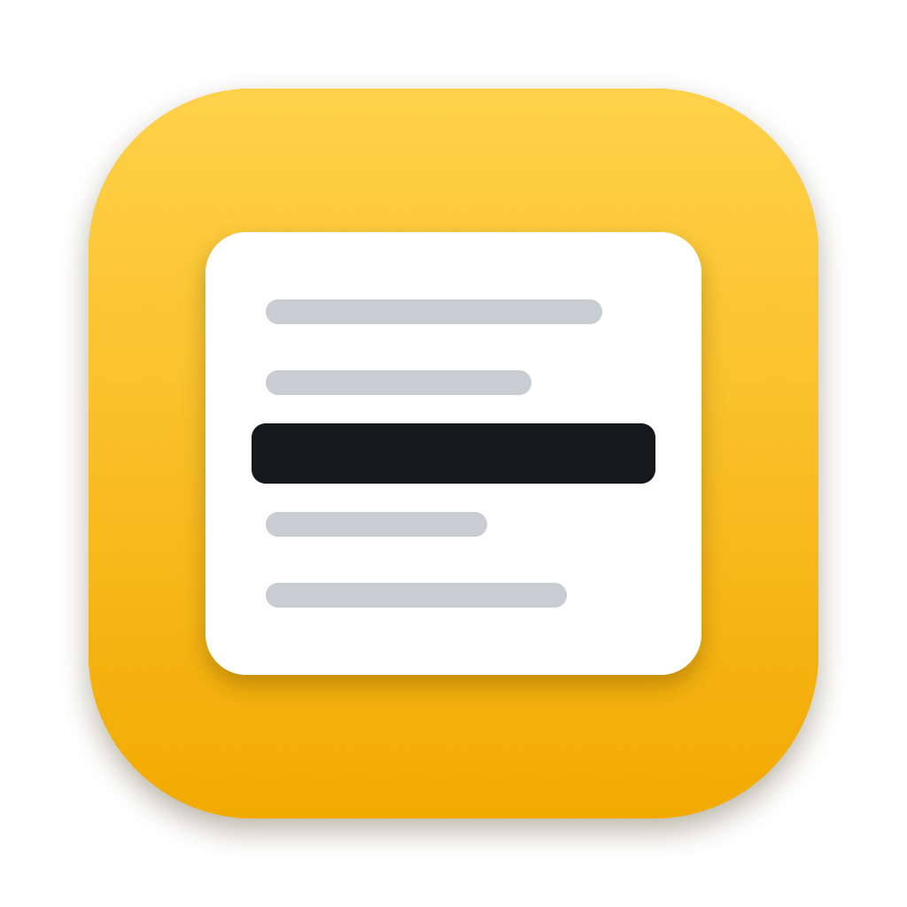
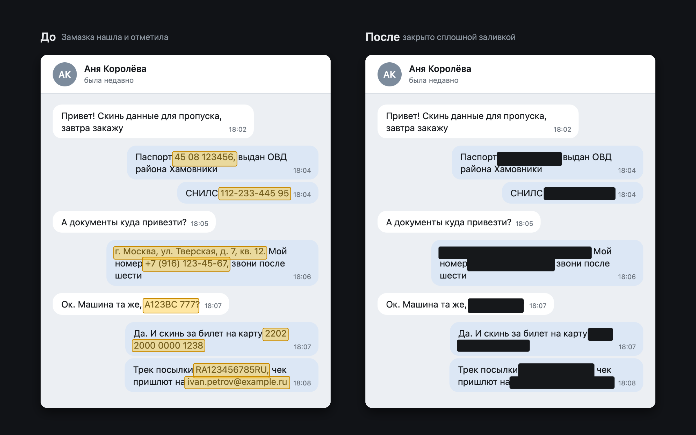
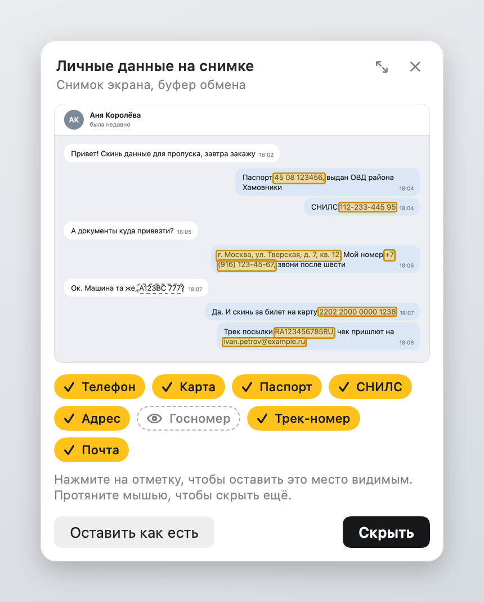

<p align="center">
  
</p>

<h1 align="center">Замазка</h1>

<p align="center">
  Прячет личные данные на скриншотах, пока они не ушли в чат.<br>
  Делаешь снимок как обычно. Если на нём есть телефон, карта, паспорт или адрес, рядом появится карточка: одно нажатие, и в файле или в буфере обмена уже очищенная копия.
</p>

<p align="center">
  <a href="https://github.com/vldvr/zamazka/releases/latest"><b>Скачать последнюю версию</b></a>
</p>



Всё считается на этом Mac. Снимки никуда не загружаются, в коде нет сетевых запросов.

## Как это выглядит



Если на снимке ничего не нашлось, Замазка ничего не показывает. Если нашлось, под значком в строке меню появляется карточка. Она не перекрывает миниатюру macOS в правом нижнем углу и окошко CleanShot у края экрана.

- **Скрыть** (Return) закрывает всё отмеченное и кладёт результат туда, откуда пришёл снимок: в тот же файл или в буфер обмена.
- Нажатие на отметку оставляет это место видимым, нажатие на ярлык под снимком оставляет видимыми все места этого вида.
- Протянуть мышью по снимку значит закрыть ещё одну область, которую Замазка не нашла.
- После «Скрыть» картинку из карточки можно перетащить прямо в Telegram.
- **Вернуть** (⌘Z) возвращает оригинал в файл или буфер одним шагом.

В настройках можно выбрать, чтобы Замазка скрывала сразу, без вопроса, и оставляла в карточке только «Вернуть».

## Откуда берутся снимки

| Источник | Как Замазка его замечает |
|---|---|
| Системный снимок в файл (⌘⇧3, ⌘⇧4, ⌘⇧5) | События файловой системы в папке для снимков. Папка берётся из настроек скриншотов macOS, при их изменении Замазка переключается сама |
| Системный снимок в буфер (⌃⌘⇧4) | Счётчик изменений буфера обмена. Содержимое читается, только если там картинка без признаков веб-страницы или документа |
| CleanShot X в файл | Та же слежка за папками плюс живой запрос Spotlight по признаку снимка, так находится и своя папка экспорта CleanShot |
| CleanShot X в буфер, кнопка Copy | Буфер обмена, а ещё папка истории CleanShot: снимок проверяется сразу после съёмки, до нажатия Copy |

И macOS, и CleanShot ставят на файл снимка расширенный атрибут `kMDItemIsScreenCapture`. Замазка читает его прямо с файла и не ждёт, пока Spotlight проиндексирует снимок. Если атрибута нет, снимок узнаётся по имени на любом языке системы, включая новое «Снимок экрана — 2026-11-07 в 12.00.00» из macOS 27.

Записи экрана и универсального доступа Замазке не нужно: она не снимает экран сама, а смотрит на то, что уже сняли.

## Что ищет

Упор на российские форматы. Где у номера есть контрольная сумма, она проверяется, поэтому случайные числа не принимаются за документ.

| Что | Как узнаётся |
|---|---|
| Телефон | +7 и 8 в любой записи, международные номера с +, номер после «тел.» |
| Карта | 13–19 цифр, проверка по алгоритму Луна, группы по 4 |
| Счёт | 20 цифр, начинается с 408 или стоит рядом со словом «счёт», «р/с» |
| Паспорт РФ | «45 08 123456», а рядом со словом «паспорт» и слитная запись, серия, номер, код подразделения |
| СНИЛС | с контрольной суммой |
| ИНН | 12 цифр с контрольной суммой, 10 цифр рядом со словом «ИНН» |
| Полис ОМС | 16 цифр рядом со словом «полис» или «ОМС» |
| Адрес | после «Адрес:», «Куда:», по улице с номером дома («ул.», «проспект», «д.», «кв.») и системным распознаванием адресов |
| Госномер | А123ВС 77 и 777, латиница и строчные тоже |
| Номер заказа, трек-номер | после «Заказ №», «Order #», «трек»; трек-номера Почты (RA…RU) с проверкой контрольной цифры |
| Имя, дата рождения | рядом с подписью: «ФИО», «Получатель», «Дата рождения» |
| Почта, IP-адрес | обычные адреса и IPv4/IPv6; домашние адреса вроде 192.168.x.x отмечаются, но выключены |
| Ключи и пароли | sk-…, ghp_…, AKIA…, AIza…, токены Telegram-ботов, JWT, приватные ключи, значения после «password=», «пароль:», пароль в строке подключения к базе |
| QR-коды и штрихкоды | целиком |
| Лица | на фото и аватарках |
| Свои слова | список в настройках: фамилия, улица, логин |

Текст распознаётся системным Vision. Подписи и значения, разнесённые по колонкам формы, сопоставляются по положению на снимке, а номер, перенесённый на другую строку, собирается обратно. Большие снимки дополнительно читаются по четвертям: на целом экране Vision иногда пропускает строки длинных ключей.

## Почему заливка, а не размытие

Размытый и пикселизованный текст восстанавливают. Для этого есть готовые инструменты: [Depix](https://github.com/spipm/Depix) подбирает текст под пиксельные блоки, [Unredacter](https://github.com/BishopFox/unredacter) делает то же для размытия. Поэтому в Замазке их нет.

- **Сплошная заливка** (по умолчанию): один цвет, в результате нет ни одного пикселя из закрытого места.
- **Под цвет фона**: цвет берётся из тонкой полосы вокруг области, снаружи, а не изнутри.
- **Шум**: выглядит как мозаика, но собран из случайных блоков в цветах окружения. Скрытые пиксели в нём не участвуют, восстанавливать нечего.

Результат сохраняется новой картинкой без слоёв, поэтому заливку нельзя сдвинуть, как прямоугольник в Просмотре. Из метаданных остаются размер и разрешение.

## Что происходит с оригиналом

Оригинал на диске тоже утечка, поэтому:

- после «Скрыть» файл снимка заменяется очищенной копией на том же месте;
- оригинал для «Вернуть» лежит только в памяти, по умолчанию 10 минут, на диск не пишется. Можно выбрать 1 минуту, час или «не хранить». Когда время выходит или программа закрывается, буфер с байтами оригинала затирается нулями;
- CleanShot хранит каждый снимок у себя в истории для окошка быстрого доступа. Замазка заменяет и эту копию: оригинал не остаётся в истории, а кнопка Copy в окошке CleanShot после «Скрыть» отдаёт уже очищенную картинку (можно выключить в настройках).

Честные ограничения:

- Пока миниатюра macOS висит в углу, файла ещё нет, а картинку из миниатюры можно перетащить в чат до проверки. Замазка предлагает выключить миниатюру.
- Если папка снимков синхронизируется с iCloud, Dropbox или Яндекс Диском, оригинал может уйти туда за секунды до замены. Замазка это замечает и предлагает сохранять снимки в «Изображения/Снимки экрана».
- Менеджеры буфера обмена (Raycast, Paste, Alfred) сохраняют картинку раньше, чем её успевает проверить кто-либо ещё. Снимки в них лучше исключить.
- На SSD с APFS замена файла не стирает старые блоки физически. От чтения диска защищает FileVault.
- Распознавание ошибается. Имя без подписи, рукописный текст, номер на фото документа под углом могут остаться незамеченными. Карточка показывает, что найдено, и позволяет закрыть остальное мышью.
- На macOS 27 первое распознавание после запуска программы занимает около 20 секунд, пока система загружает модель. Замазка прогревает её при старте, пока идёт проверка, значок в строке меню мигает.

## Установка

Нужна macOS 14 или новее, Apple silicon или Intel.

### Собрать у себя (рекомендуется)

Нужны только Command Line Tools (`xcode-select --install`), Xcode не обязателен.

```bash
git clone https://github.com/vldvr/zamazka.git
cd zamazka
swift run zamazka-checks          # проверки на синтетических данных
scripts/build-app.sh --install     # сборка и копия в /Applications
```

Собранное на своём Mac приложение не получает карантинный атрибут, поэтому Gatekeeper не просит его разрешать. И запускается ровно тот код, который лежит перед глазами. Для программы, которая видит все скриншоты, это честнее, чем просить доверять готовому файлу.

### Готовый образ

На странице [последней версии](https://github.com/vldvr/zamazka/releases/latest) лежат `Zamazka-…-macOS.dmg` и его SHA-256. У проекта нет платного сертификата Apple, поэтому при первом запуске macOS скажет, что не может проверить разработчика. Открыть можно в «Системных настройках», раздел «Конфиденциальность и безопасность», кнопка «Всё равно открыть».

Перед этим образ можно проверить:

```bash
shasum -a 256 -c Zamazka-1.0.0-macOS.dmg.sha256
gh attestation verify Zamazka-1.0.0-macOS.dmg --repo vldvr/zamazka
```

Вторая команда проверяет подпись происхождения (Sigstore): образ собран GitHub Actions из этого репозитория, из коммита с тегом версии, а не на чьём-то компьютере.

Убрать предупреждение Gatekeeper совсем можно только сертификатом Developer ID и нотаризацией Apple (99 $ в год). Cask в Homebrew не поможет: он скачивает тот же файл с тем же карантином, а снимать карантин скриптом значит обходить проверку молча.

## Разрешения

- Доступ к папке, куда сохраняются снимки, если это Рабочий стол, Документы или Загрузки. macOS спросит один раз.
- Вставка из других приложений. В новых macOS система может спрашивать, можно ли программе читать буфер обмена. Замазка читает его, только когда там картинка.
- Открытие при входе в систему выключено. Включается переключателем в настройках.

## Разработка

```bash
swift run zamazka-checks                 # детектор, заливка, файлы, буфер, «Вернуть»
scripts/build-app.sh --native            # быстрая сборка под этот Mac
scripts/build-app.sh --dmg               # Apple silicon + Intel и dist/Zamazka-<версия>-macOS.dmg

Zamazka --sample chat chat.png           # выдуманный снимок для опытов
Zamazka --scan chat.png                  # что найдено, по строке на находку
Zamazka --redact chat.png clean.png      # закрыть всё найденное
Zamazka --snap card card.png             # картинки для README
Zamazka --hero before-after.png
```

Все проверки и картинки в README сделаны на выдуманных данных с правильными контрольными суммами. Настоящих документов в репозитории нет.

Журнал событий для отладки источников: `defaults write com.vldvr.zamazka debugLog -bool true`, затем `~/Library/Logs/Zamazka.log`. В журнал пишутся события и типы данных в буфере, распознанный текст туда не попадает.

## Лицензия

[MIT](LICENSE)
